# macOS Ventura Virtualization | VirtualBox Installation Lab

[](https://www.virtualbox.org/)
[](https://support.apple.com/macos)
[](#skills-demonstrated)
[](#lab-environment)

**Maintained by:** Alexander Cox  
**Project context:** Advanced Operating Systems coursework — Caribbean Maritime University (November 2024)  
**Source:** `macOS Group 1(1).docx` (original lab report)  
**Scope:** VM creation, installation-media attachment, VirtualBox configuration, macOS recovery, disk formatting, installer workflow, and startup troubleshooting.

> **Attribution:** The source report credits Alexander Cox, Davain Forrester, and Javaun Lee-Delvalie. The source does not itemize individual contributions; this repository documents the submitted lab workflow without claiming each step was performed by one person alone.
>
> **Compatibility and licensing:** This is documentation of a historical coursework experiment, **not** a claim that Oracle VirtualBox officially supports every macOS/host combination. macOS virtualization must comply with Apple's applicable license terms and supported-host requirements. Use legitimately obtained installation media on authorized hardware.

## Objective

The objective of this lab was to create and configure a **macOS Ventura virtual machine in Oracle VirtualBox**, explore virtualization settings, complete the macOS recovery and installation workflow, and document common compatibility and performance issues.

The exercise provided practical experience managing virtual machine hardware settings, attaching installation media, changing advanced VM settings with `VBoxManage`, preparing an APFS disk, and working through first-run network configuration.

## Skills Demonstrated

- Virtual machine creation and guest OS selection in Oracle VirtualBox.
- Virtual storage and optical media configuration.
- USB controller selection and hardware compatibility considerations.
- Windows Command Prompt navigation and `VBoxManage` command-line administration.
- Virtual firmware identity settings (EFI/DMI/SMC) and troubleshooting.
- macOS Recovery, Disk Utility, APFS formatting, and GUID partition layout.
- macOS installation progress monitoring and network setup.
- Evidence-based troubleshooting of boot, performance, resource, and USB issues.

## Tools and Components

| Component | Role |
| --- | --- |
| [Oracle VirtualBox](https://www.virtualbox.org/) | Hypervisor used to create and run the VM. |
| `VBoxManage.exe` | Command-line configuration of VirtualBox settings. |
| Windows Command Prompt | Executed VM configuration commands on the host. |
| macOS Ventura installer image | Installation media attached to a virtual optical drive. |
| macOS Recovery / Disk Utility | Disk initialization and installation preparation. |
| APFS / GUID Partition Map | macOS-compatible virtual-disk format and partition scheme. |
| VirtualBox USB controller | Guest-device compatibility setting. |

## Lab Environment

```text
Host computer (Windows)
|
+-- Oracle VirtualBox
    |
    +-- VM: "Macos Ventura"
        |-- Guest type: Mac OS X (64-bit)
        |-- Virtual hard disk: approximately 40.76 GB shown
        |-- Virtual optical drive: Ventura installer image (14.65 GB shown)
        |-- USB controller: xHCI / USB 3.0 selected
        |-- Advanced VirtualBox CPU / EFI / SMC settings
        |-- macOS Recovery and Disk Utility
        +-- macOS Ventura installation / desktop
```

**Topology note:** This is a **single-VM logical workflow**, not a network segment diagram. The screenshots do not provide a confirmed static guest IP address, router, subnet, or end-to-end network test, so none is invented here.

---

## Implementation and Evidence

### 1. Create the macOS Ventura virtual machine

I opened VirtualBox and started the **Create Virtual Machine** wizard. The VM was named `Macos Ventura`, and the operating system selections were **Mac OS X** and **Mac OS X (64-bit)**.

**Why this matters:** Choosing the matching guest family helps establish a VM configuration appropriate to the intended operating system. Naming the VM consistently is also important: `VBoxManage` refers to the exact VM name in later commands.

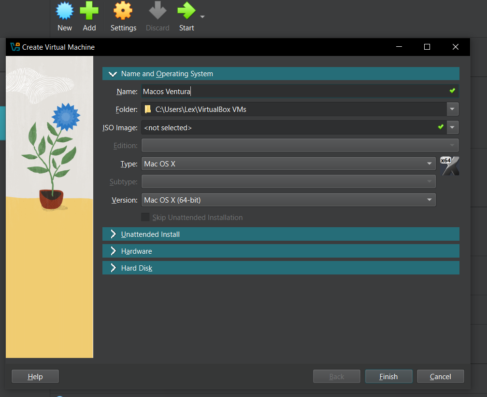

*Figure 1 — VirtualBox wizard showing the VM name, operating system family, and 64-bit guest selection.*

### 2. Obtain and select installation media

The report documents a **14.65 GB** macOS Ventura installer image saved on the Windows host. The following screenshots show the image source page and a locally selected file.

**Why this matters:** VirtualBox needs accessible installation or recovery media before the guest can start the installation workflow. Confirm that image files are authentic, complete, and used under appropriate license terms; the original report does not independently verify the image's provenance or checksum.

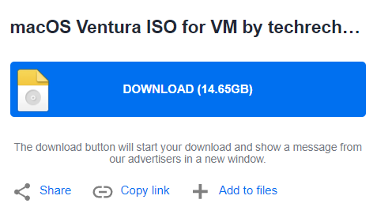

*Figure 2 — Installer image download screen captured in the original report.*

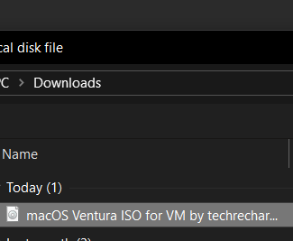

*Figure 3 — Local file-selection window containing the macOS Ventura installer image.*

### 3. Attach the image to VirtualBox storage

In **VM Settings → Storage**, the installer image was attached to the virtual optical drive on the SATA controller. The storage view shows both the virtual hard disk and attached installer image.

**Why this matters:** The virtual optical drive lets the guest boot into the installer/recovery environment, while the virtual hard disk provides a destination for the operating system.

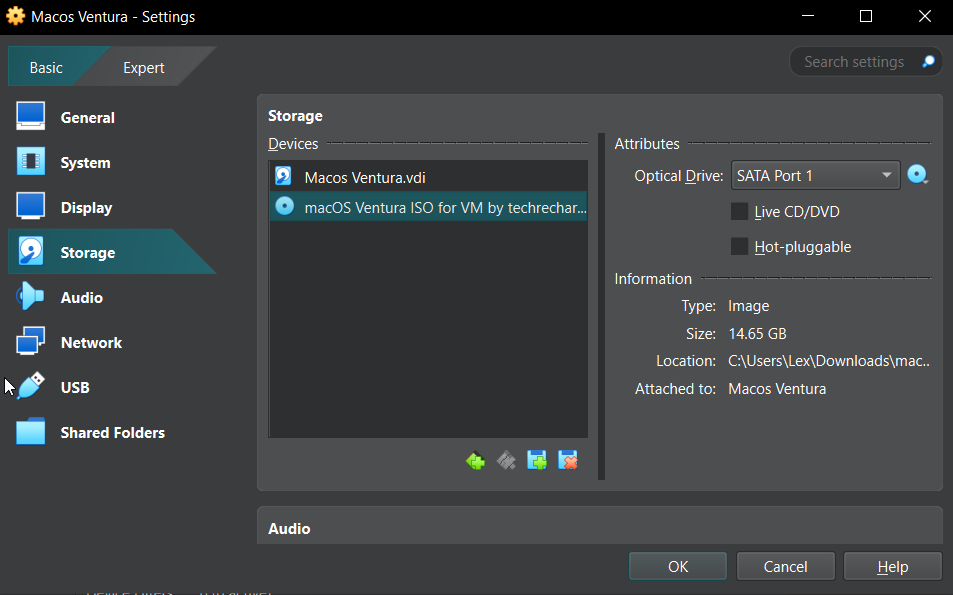

*Figure 4 — VirtualBox Storage settings with the macOS virtual disk and installer image attached.*

### 4. Configure the USB 3.0 controller

In **VM Settings → USB**, the USB controller was enabled and **USB 3.0 (xHCI)** was selected.

**Why this matters:** xHCI provides the USB controller model exposed to the guest. This can matter for input or other USB peripherals, although merely selecting the controller does **not** prove device passthrough works. The report later records USB recognition issues and discusses the Extension Pack as a troubleshooting step.

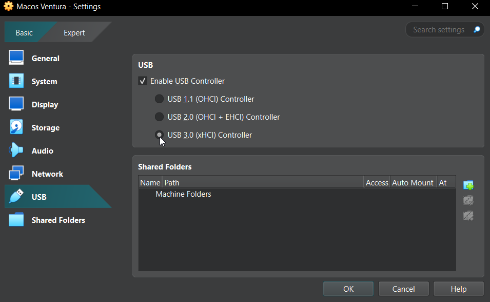

*Figure 5 — VirtualBox USB settings showing the xHCI controller option.*

### 5. Apply advanced VirtualBox configuration from Command Prompt

The host's Windows Command Prompt was used to navigate to the VirtualBox installation directory and run `VBoxManage` commands for CPU identity and guest firmware/platform configuration.

**Command shown for changing directories:**

```bat
cd "C:\Program Files\Oracle\VirtualBox\"
```

**What it does:** Changes the current command-line directory to the folder containing `VBoxManage.exe`. This makes it possible to run the executable without supplying its full path each time.

**Selected settings visible in the screenshot (illustrative syntax):**

```bat
VBoxManage.exe setextradata "Macos Ventura" "VBoxInternal/Devices/efi/0/Config/DmiSystemProduct" "iMac19,3"
VBoxManage.exe setextradata "Macos Ventura" "VBoxInternal/Devices/efi/0/Config/DmiSystemVersion" "1.0"
VBoxManage.exe setextradata "Macos Ventura" "VBoxInternal/Devices/efi/0/Config/DmiBoardProduct" "Iloveapple"
```

| Command or option | Purpose |
| --- | --- |
| `VBoxManage.exe` | VirtualBox's command-line management program. |
| `modifyvm` | Changes a VM's configuration. In this screenshot it was used with `--cpuidset`. |
| `--cpuidset` | Sets the guest-visible processor identification values. |
| `setextradata` | Writes advanced VirtualBox metadata for a named VM. |
| `VBoxInternal/Devices/efi/.../DmiSystemProduct` | Sets a guest-visible firmware model identifier. |
| `DmiSystemVersion` / `DmiBoardProduct` | Modifies further firmware identity fields. |
| `VBoxInternal/Devices/smc/...` | Advanced system-management-controller settings visible in the screenshot. |

**Interpretation:** These values were used as part of the documented compatibility experiment. They are **not a generic, supported installation recipe**; copying them to another host may fail and may raise platform-license issues. The screenshot also shows CPU-ID and SMC-related commands, but the report does not provide independently verified hardware compatibility or a reusable configuration export.

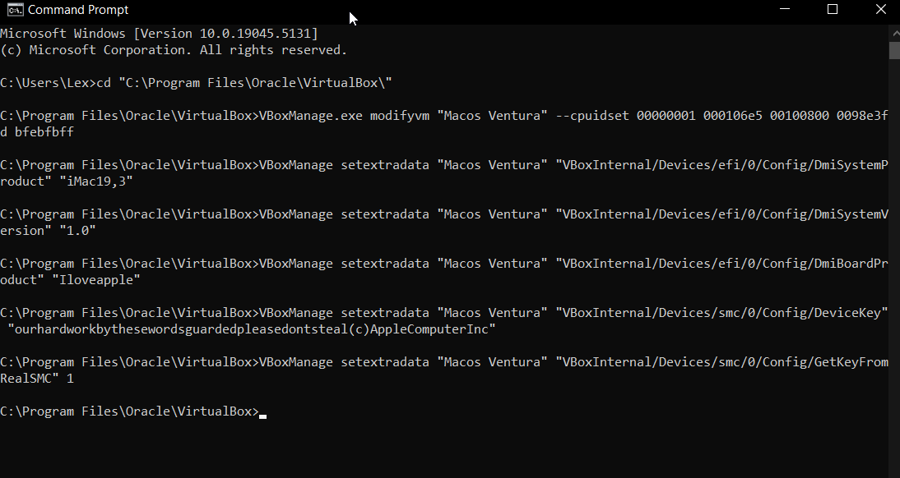

*Figure 6 — Windows Command Prompt showing `VBoxManage` configuration of CPU identification and firmware/platform parameters.*

### 6. Start the VM and enter macOS Recovery

After starting the VM, the report shows the macOS language selection screen, followed by macOS Recovery utilities.

**Why this matters:** Reaching these screens establishes that the VM booted into the installer/recovery environment. It does not, by itself, confirm a fully installed guest system.

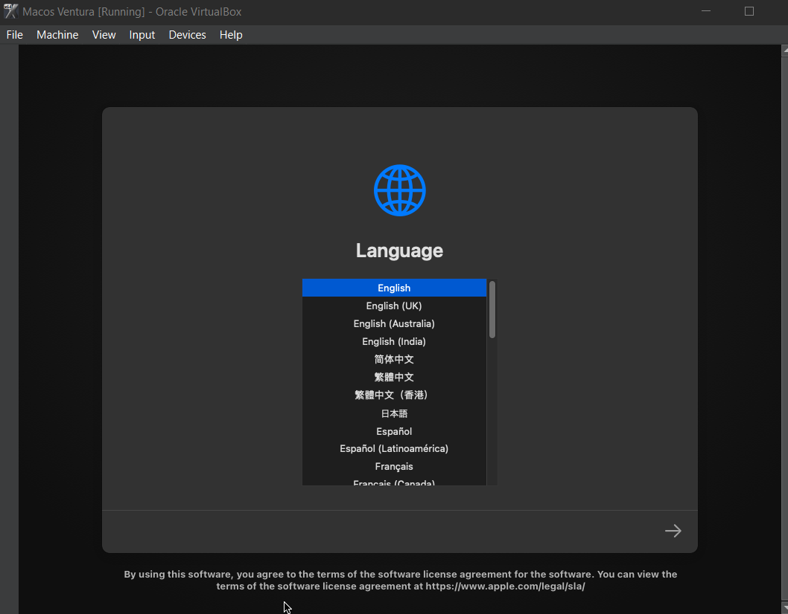

*Figure 7 — Language selection after booting the Ventura installer.*

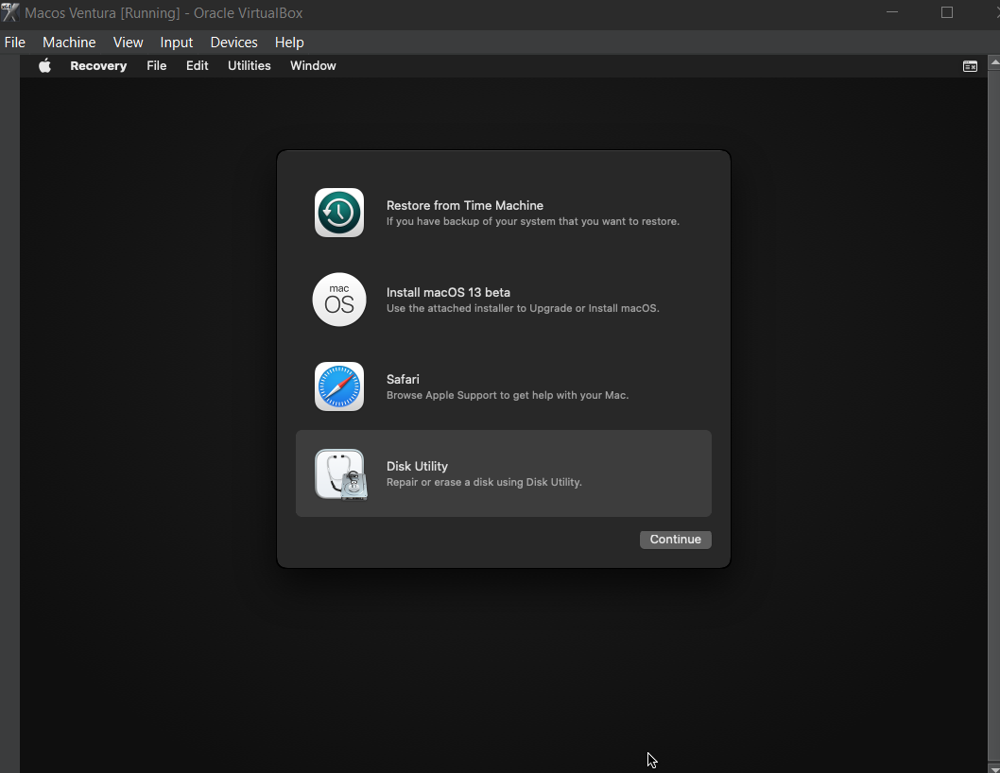

*Figure 8 — macOS Recovery utilities, including Disk Utility and the macOS installation option.*

### 7. Prepare the virtual disk using Disk Utility

Disk Utility was used to initialize the VM's virtual hard disk. The screenshot shows **APFS** as the format and **GUID Partition Map** as the scheme.

**Why this matters:**

- **APFS** is the filesystem used for modern macOS installations.
- **GUID Partition Map (GPT)** provides the disk partition layout commonly required for modern EFI-based macOS installation.
- Preparing the **virtual** disk creates an installation target without intentionally modifying the physical host disk.

**Safety note:** Erasing the wrong disk destroys its contents. Verify the selected virtual disk before using the Erase action.

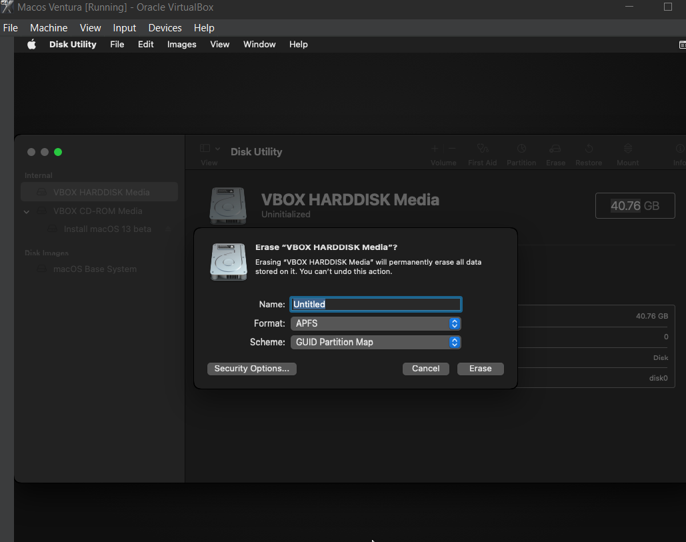

*Figure 9 — Disk Utility showing APFS and GUID Partition Map for the virtual hard disk.*

### 8. Review and accept the software license

The installer displayed the **macOS 13 beta** software license agreement, which was acknowledged as part of the installation workflow.

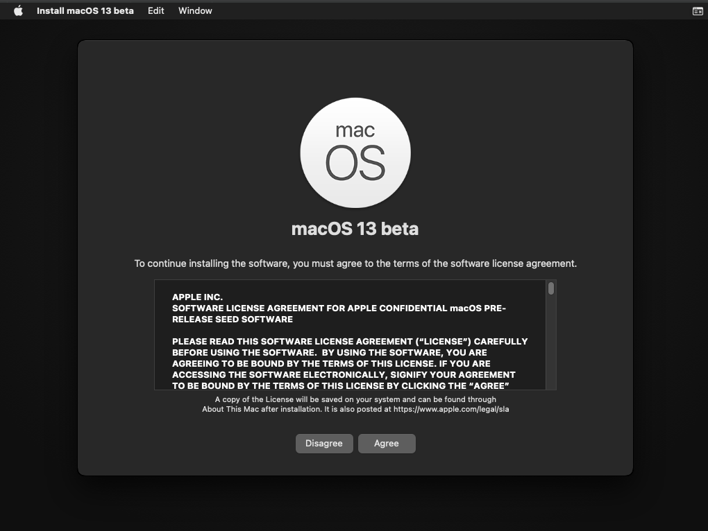

*Figure 10 — Installer displaying the macOS 13 beta license agreement.*

### 9. Select the formatted installation destination

The prepared disk, labeled `MacOS Ventura`, was selected as the installation destination. The screenshot shows approximately **40.76 GB** disk capacity and about **40.46 GB available**.

**Why this matters:** The installer must target a formatted virtual disk with sufficient space. The visible capacity describes the virtual installation disk, not the host's total storage.

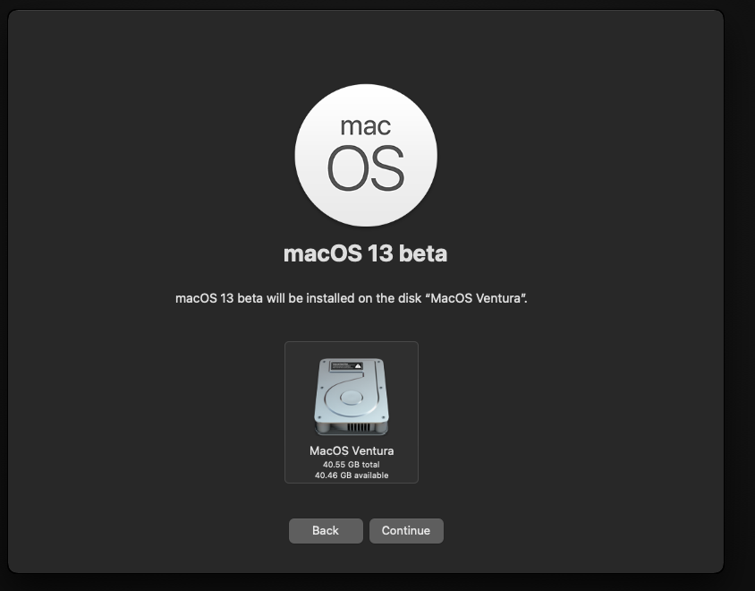

*Figure 11 — macOS installer targeting the prepared `MacOS Ventura` virtual disk.*

### 10. Monitor installation progress

The report captures the Apple logo and macOS installation progress bar with approximately **29 minutes remaining** at that moment.

**Why this matters:** Installation and first startup can take time on virtual hardware. The time shown is a snapshot, not proof of the total elapsed installation time.

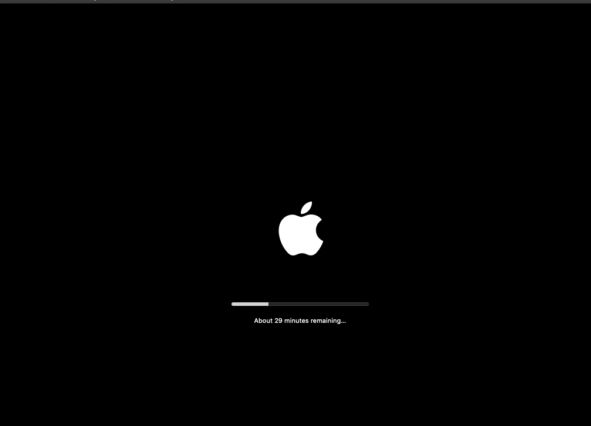

*Figure 12 — Installer progress screen during macOS Ventura setup.*

### 11. Configure initial network access

The first-run setup page shows **Local network (Ethernet)** selected as the connection method.

**Why this matters:** A virtual network adapter can be used to provide network access to the guest. The report discusses **NAT** and **Bridged Adapter** settings as alternatives when troubleshooting connectivity.

> **Evidence limit:** Selecting Ethernet in setup does not independently verify DNS resolution, internet access, or a functioning guest IP configuration. No successful guest `ping` or `ifconfig` output is included in this report.

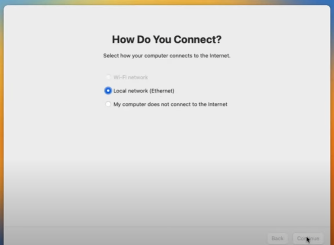

*Figure 13 — Initial macOS setup screen with Local network (Ethernet) selected.*

### 12. Reach the macOS desktop

The final screenshot shows a macOS desktop with the Finder menu bar, Dock, Ventura wallpaper, and an installer icon. The report describes this as the completed desktop environment.

**Outcome:** The evidence supports that the VM reached a graphical macOS environment. The source does **not** include performance benchmarks, full hardware-compatibility tests, network diagnostic output, or proof of continued stability after repeated restarts.

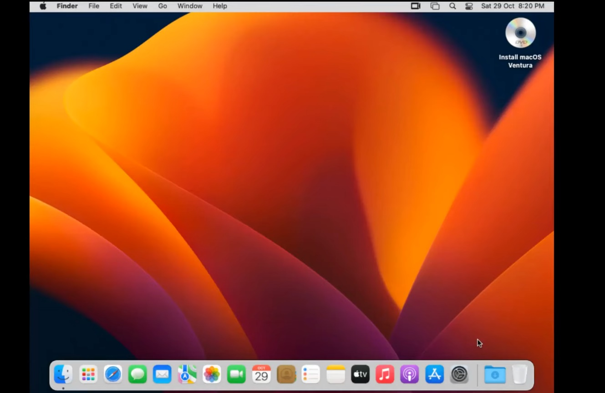

*Figure 14 — macOS Ventura desktop captured at the end of the reported lab workflow.*

---

## Configuration and Troubleshooting

The original report documents these issues and responses. They are presented as **reported lab observations**, not independently reproduced tests.

| Challenge | Reported response | What to verify when reproducing |
| --- | --- | --- |
| Boot loops / kernel panics | Reviewed advanced VM settings and VirtualBox compatibility. | Confirm supported host/guest combination; review VM logs and firmware settings. |
| Slow installation | Increased virtual CPU/RAM allocations and reduced competing host workloads. | Confirm resources are available on the host; avoid over-allocation. |
| No internet in guest | Reviewed NAT/Bridged Adapter settings. | Check adapter mode, guest IP, DNS, gateway, and connectivity separately. |
| USB devices not recognized | Investigated USB controller options and Extension Pack support. | Confirm version compatibility and test an actual peripheral. |
| Compatibility adjustments | Used `VBoxManage` for CPU identification and EFI/SMC metadata. | Document precise host hardware, hypervisor version, and legal compatibility before reproducing. |

## Results and Evidence Summary

| Milestone | Evidence | Status supported by report |
| --- | --- | --- |
| Create macOS VM | Figure 1 | VM configured in the creation wizard. |
| Acquire and attach image | Figures 2–4 | Local installer media selected and attached. |
| Configure USB and advanced settings | Figures 5–6 | Settings selected and commands entered. |
| Boot into Recovery | Figures 7–8 | Installer/recovery interface visible. |
| Prepare APFS virtual disk | Figure 9 | APFS/GUID format options shown. |
| Select installation target | Figures 10–11 | License and target selection shown. |
| Start installation | Figure 12 | Installation progress visible. |
| Choose network connection | Figure 13 | Ethernet selected; network connectivity not independently validated. |
| Launch desktop | Figure 14 | Graphical macOS desktop visible. |

## Key Takeaways

The project strengthened familiarity with **VM provisioning, virtual storage, guest firmware configurations, command-line hypervisor management, and operating-system installation**. It also highlighted the need to record detailed system requirements and validate boot, networking, peripheral support, and performance separately rather than assuming successful installation guarantees full compatibility.

**Future validation steps** (not claimed as completed in the report): capture guest network configuration, check software/update status, test reboot persistence, record CPU and RAM assignments, and document repeatable snapshots on a supported configuration.

## Source and Project Context

This README is based on **`macOS Group 1(1).docx`**, an Advanced Operating Systems lab submitted November 25, 2024 at Caribbean Maritime University. The repository screenshots were extracted directly from the embedded document media and arranged to match the actual steps. The original report credits Alexander Cox, Davain Forrester, and Javaun Lee-Delvalie.

For a full screenshot-to-source mapping, see [SCREENSHOT-GUIDE.md](SCREENSHOT-GUIDE.md).

## References

- [Oracle VirtualBox documentation](https://www.virtualbox.org/manual/)
- [VirtualBox downloads](https://www.virtualbox.org/wiki/Downloads)
- [Apple macOS support](https://support.apple.com/macos)
- [Apple software license agreements](https://www.apple.com/legal/sla/)

---

**Alexander Cox** · [GitHub](https://github.com/KerberosAC) · [LinkedIn](https://www.linkedin.com/in/alexandercox25/)
